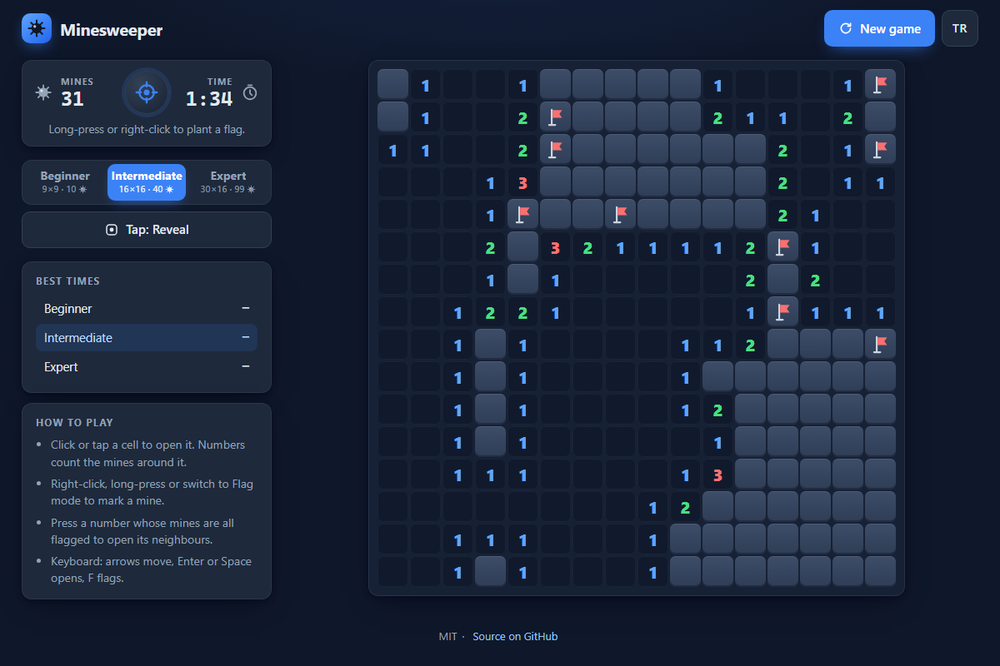

# Minesweeper - the classic mine-clearing puzzle, rebuilt in vanilla JavaScript for desktop and phone

[](#tests)
[](LICENSE)

**▶ Play now: https://celaldrg.github.io/minesweeper/**



## Features

- Three boards: Beginner 9×9 with 10 mines, Intermediate 16×16 with 40, Expert 30×16 with 99.
- Your first click is always safe. Mines are placed after it, so the clicked cell and its neighbours are clear.
- Empty areas open in one go (an iterative flood fill), plus flags, chording, a timer and a mines-left counter.
- Your best time on each board is saved in the browser.
- Mouse, keyboard and touch controls, including long-press and a Reveal/Flag mode toggle for phones.
- English and Turkish UI. Your language choice is remembered.
- Dark theme that respects `prefers-reduced-motion`.
- No dependencies, no build step and no network requests. It is just HTML, CSS and ES modules.

## How to play

Open every cell that has no mine. A number shows how many mines touch that cell.

| Action | Mouse / keyboard | Touch |
| --- | --- | --- |
| Open a cell | Left-click, or Enter / Space | Tap |
| Place or remove a flag | Right-click (or Ctrl+click), or F | Long-press (~0.4 s), or switch the mode button to *Flag* and tap |
| Chord: open all neighbours of a number whose mines are flagged | Click the number | Tap the number |
| Move between cells | Arrow keys | – |
| New game | *New game* button or the round status button | same |

On narrow screens the Expert board scrolls inside its own frame. The page itself never scrolls sideways.

## Run locally

ES modules need `http://`, so opening `index.html` with `file://` will not work. You can use any static server:

```sh
npx serve .
# or
python3 -m http.server 8000
```

Then open the address the server prints.

## Tests

```sh
node --test
```

The tests use only `node:test` and `node:assert`, so there is nothing to install. They are deterministic because every board comes from a seeded random generator. They cover:

- **Flood fill:** on a hand-made board, it opens exactly the connected empty region and its numbered border.
- **Safe first click:** across 500 seeds on every difficulty, the first click is never a mine, and on dense boards only the clicked cell is kept clear.
- Neighbour counts, chording (including a wrong flag), flags and the mines-left counter, and win and loss detection.
- Best-time records, the demo board, the seeded generator, EN/TR string parity, the storage helper when storage is blocked, and time formatting.

GitHub Actions runs the same command on every push and pull request.

## Project structure

```
index.html            page shell, SVG icon sprite
style.css             dark theme, responsive layout
src/
  rng.js              seeded generator (mulberry32)
  board.js            presets, neighbours, mine placement, flood fill
  game.js             rules: reveal, chord, flags, win/loss, clock
  records.js          best times per difficulty
  demo.js             the ?demo mid-game board used for the screenshot
  i18n.js             English and Turkish strings
  storage.js          localStorage wrapped in try/catch
  format.js           time formatting
  board-view.js       DOM grid, sizing, focus
  input.js            pointer, long-press and keyboard input
  panel.js            HUD, buttons, best times
  main.js             wires it all together
test/                 node:test suites
```

## License

[MIT](LICENSE) © 2026 Celalettin Durgaç

---

## Türkçe

Klasik mayın tarlası bulmacası. Vanilla JavaScript ile yeniden yazıldı, masaüstünde ve telefonda oynanır.

**▶ Hemen oyna: https://celaldrg.github.io/minesweeper/**

### Özellikler

- Üç tahta var: Başlangıç 9×9 (10 mayın), Orta 16×16 (40 mayın), Uzman 30×16 (99 mayın).
- İlk tıklama her zaman güvenlidir. Mayınlar bu tıklamadan sonra yerleştirilir, böylece tıklanan hücrede ve komşularında mayın olmaz.
- Boş alanlar tek seferde açılır (yinelemeli taşma dolgusu). Bayrak, akor açma, süre ve kalan mayın sayacı da var.
- Her tahtadaki en iyi süren tarayıcıda saklanır.
- Fare, klavye ve dokunmatik kontroller var. Telefonda basılı tutma ve Aç/Bayrak mod düğmesi de kullanılabilir.
- Arayüz İngilizce ve Türkçe. Dil seçimin hatırlanır.
- Koyu tema `prefers-reduced-motion` ayarına uyar.
- Bağımlılık, derleme adımı ve ağ isteği yok. Yalnızca HTML, CSS ve ES modülleri.

### Nasıl oynanır

Mayın olmayan bütün hücreleri aç. Bir hücredeki sayı, ona değen mayınların sayısıdır.

| Eylem | Fare / klavye | Dokunmatik |
| --- | --- | --- |
| Hücre aç | Sol tık ya da Enter / Boşluk | Dokun |
| Bayrak koy / kaldır | Sağ tık (ya da Ctrl+tık) ya da F | Basılı tut (~0,4 sn) ya da mod düğmesini *Bayrak* yapıp dokun |
| Akor: mayınları bayraklanmış bir sayının komşularını aç | Sayıya tıkla | Sayıya dokun |
| Hücreler arasında gezin | Ok tuşları | – |
| Yeni oyun | *Yeni oyun* düğmesi ya da yuvarlak durum düğmesi | aynı |

Dar ekranlarda Uzman tahtası kendi çerçevesi içinde kayar. Sayfanın kendisi hiçbir zaman yana kaymaz.

### Yerelde çalıştırma

ES modülleri `http://` ister, bu yüzden `index.html` dosyasını `file://` ile açmak çalışmaz. Herhangi bir statik sunucu kullanabilirsin:

```sh
npx serve .
# ya da
python3 -m http.server 8000
```

Sonra sunucunun yazdığı adresi aç.

### Testler

```sh
node --test
```

Testler yalnızca `node:test` ve `node:assert` kullanır, kurulacak bir şey yoktur. Her tahta tohumlu rastgele üreteçten geldiği için sonuçlar her seferinde aynıdır. Kapsadıkları:

- **Taşma dolgusu:** elle çizilmiş bir tahtada tam olarak bağlı boş bölgeyi ve sayılı kenarını açar.
- **Güvenli ilk tıklama:** her zorlukta 500 tohum boyunca ilk tıklama hiç mayına denk gelmez. Yoğun tahtalarda yalnızca tıklanan hücre boş bırakılır.
- Komşu sayıları, akor açma (yanlış bayrak dahil), bayraklar ve kalan mayın sayacı, kazanma ve kaybetme.
- Rekor süreler, demo tahtası, tohumlu üreteç, EN/TR metinlerinin eşleşmesi, depolama engelliyken depolama yardımcısı ve süre biçimi.

GitHub Actions aynı komutu her push ve pull request'te çalıştırır.

### Lisans

[MIT](LICENSE) © 2026 Celalettin Durgaç
